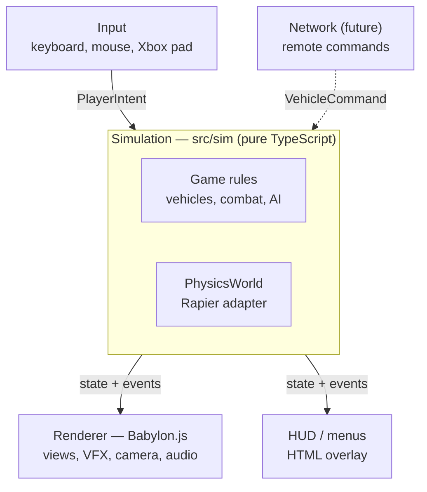
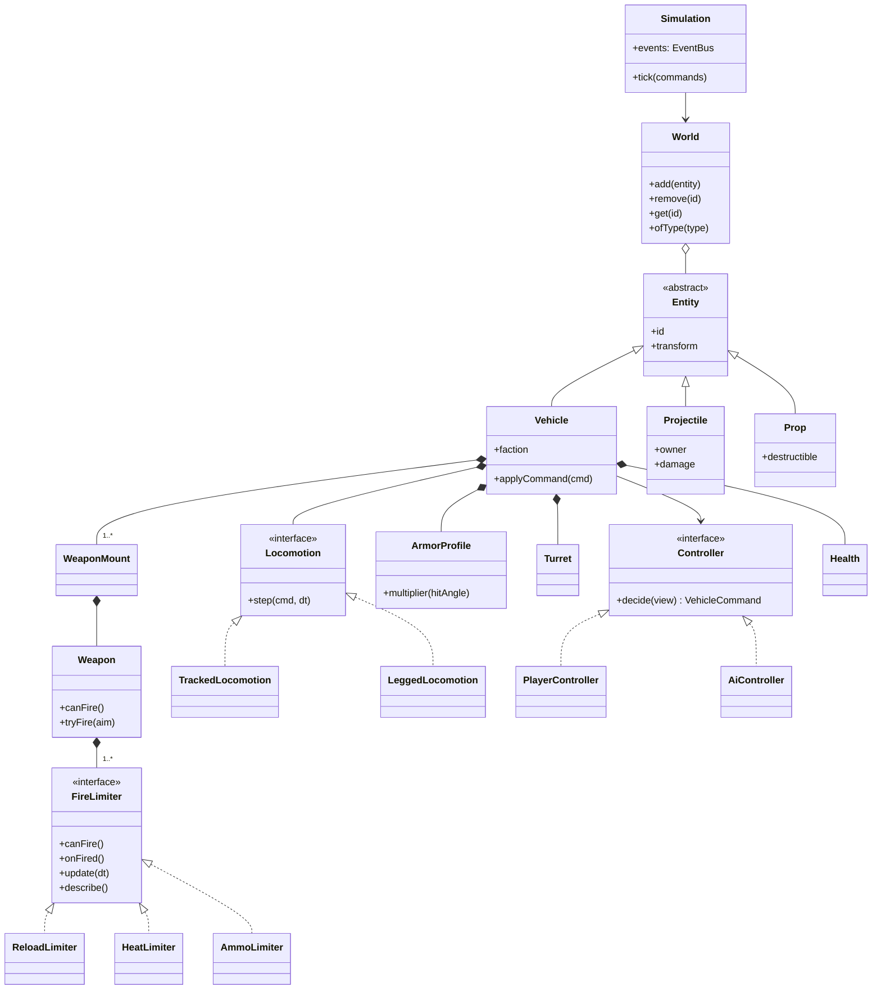

# Architecture

_Working title: **Hardpoint**. Last updated 2026-11-18. Decisions referenced: ADR-0001 to ADR-0004._

## 1. Layers



**Dependency rule:** `src/sim/` imports nothing from `render/`, `input/`, `ui/`, `app/` or `@babylonjs/*`. ESLint enforces this; CI fails on violation.

## 2. Folder layout

```
src/
  sim/
    core/        Simulation, World, Entity, EventBus, Rng, FixedClock, math
    vehicles/    Vehicle, Turret, WeaponMount, VehicleFactory
      locomotion/   Locomotion (interface), TrackedLocomotion
      controllers/  Controller (interface), PlayerController, AiController
    combat/      Weapon, Projectile, ArmorProfile, Health, DamageResolver
      limiters/     FireLimiter (interface), ReloadLimiter, HeatLimiter
    ai/          Pathfinder (grid A*), behavior states
    physics/     PhysicsWorld (interface), RapierPhysicsWorld
    arena/       Arena, ArenaDef
    modes/       GameMode (interface), WaveSurvivalMode, WaveDef
    defs/        vehicles.ts, weapons.ts, armor.ts, arenas.ts
  render/        RenderBridge, views/, vfx/, camera/, audio/
  input/         InputManager, KeyboardMouseDevice, GamepadDevice
  ui/            Hud, menus
  app/           main.ts — wiring and the main loop
tests/           mirrors src/sim/
docs/            this folder
```

## 3. Simulation core classes



`LeggedLocomotion` and `AmmoLimiter` are future implementations, shown to demonstrate the extension points.

## 4. Extension points

| Interface | Slice implementations | Future | What it swaps |
|---|---|---|---|
| `Locomotion` | `TrackedLocomotion` | `LeggedLocomotion`, hover | Handling (speed, turn rate, strafing) and control mapping. All drive the same simple collision body |
| `Controller` | `PlayerController`, `AiController` | `RemoteController` (co-op) | Who drives a vehicle. Player and enemies share `Vehicle` |
| `FireLimiter` | `ReloadLimiter` (cannon), `HeatLimiter` (MG) | `AmmoLimiter`, burst, charge-up | How a weapon is gated. A weapon fires only if **all** its limiters allow |
| `PhysicsWorld` | `RapierPhysicsWorld` | test fakes | Collision/physics engine |
| `GameMode` | `WaveSurvivalMode` | `RoomClearMode` (Robokill-style) | Spawning, progression and win/lose conditions. Vehicles, combat and AI are unchanged across modes |

**Content is data.** `VehicleDef`, `WeaponDef` and `ArmorDef` are typed TypeScript objects. `VehicleFactory` assembles a `Vehicle` from a def. The insurgent tank is the player's classes plus a different def, faction and `AiController`.

## 5. One frame

1. **Input:** devices produce a `PlayerIntent` (throttle, turn, aim point, fire primary/secondary).
2. **Fixed-step simulation (60 Hz),** run 0..n times per frame to catch up:
   1. Each `Controller` produces a `VehicleCommand`.
   2. `Locomotion.step` moves vehicles; `PhysicsWorld` resolves collisions.
   3. Turrets traverse toward aim; weapons update limiters and fire.
   4. Projectiles advance (swept/ray tests, no tunneling); hits go to `DamageResolver`.
   5. `DamageResolver` applies `ArmorProfile.multiplier(hitAngle)` → `Health`.
   6. `GameMode.update` spawns enemies and checks win/lose.
   7. Events are emitted: `ShotFired`, `Hit`, `EntityDestroyed`, `WeaponStateChanged`, `WaveStarted`, `RunEnded`.
3. **Render:** `RenderBridge` keeps one view per entity id, interpolates between the last two ticks, and applies state to Babylon nodes.
4. **React to events:** VFX, camera shake, hit-stop, audio and HUD subscribe to simulation events. The simulation never calls "play explosion."

## 6. Render layer

- **`RenderBridge`:** creates and destroys views as entities appear and disappear; maps entity id → view.
- **Views** (`VehicleView`, `ProjectileView`, `PropView`): own Babylon meshes; read-only access to entity state. A future `WalkerView` owns a procedural `LegRig` (2-bone IK, foot planting). The legs are cosmetic, with no simulation impact.
- **VFX:** Babylon particle systems (presets and Node Particle Editor assets) triggered by events, plus "juice": screen shake, hit-stop, muzzle-flash lights, bloom.
- **Camera:** high angle between top-down and isometric, smoothed follow.

## 7. Input

- `KeyboardMouseDevice`: WASD hull-relative driving, mouse aim (ray to ground plane), LMB/Space = primary, RMB/F = secondary.
- `GamepadDevice` (Xbox, standard mapping): left stick tank-style (Y = throttle, X = turn), right stick aims, RT = primary, LT = secondary. Browsers expose a pad only after a button press.
- Devices output the same `PlayerIntent`, so the simulation doesn't know which device is in use.

## 8. Determinism and testing

- No `Math.random()` or `Date.now()` in `src/sim/` (lint). Use `Rng` and tick counts.
- Vitest covers the simulation directly. Examples:
  - A cannon hit 10° off the front deals front-armor damage.
  - `HeatLimiter` blocks fire at max heat and re-arms at the threshold.
  - A weapon with two limiters fires only when both allow it.
  - The AI finds a path around a crate.
  - The same seed and command stream produce the same final state.
- CI: lint (including import boundaries), typecheck, tests, build.
