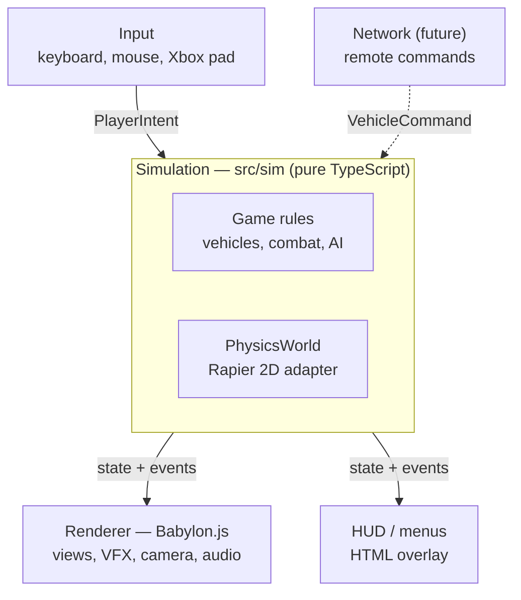
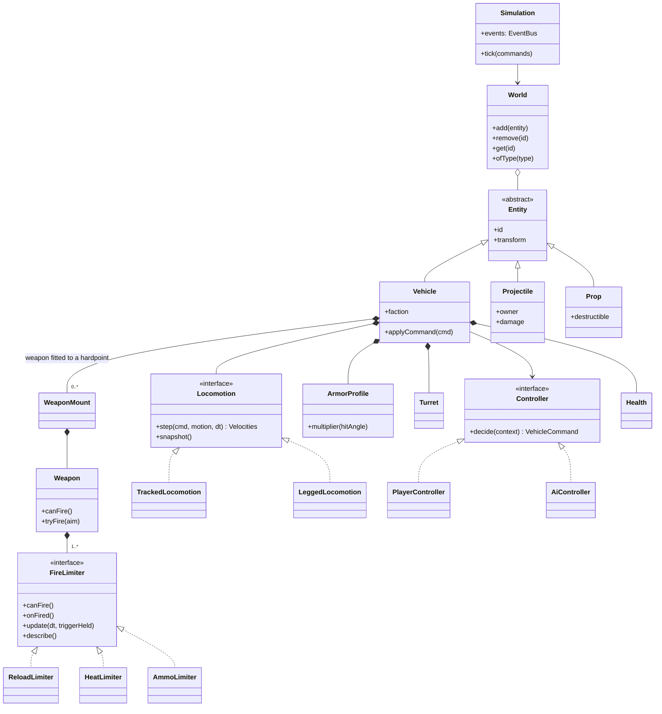

# Architecture

_Working title: **Hardpoint**. Last updated 2026-11-19. Decisions referenced: ADR-0001 to ADR-0005._

## 1. Layers



**Dependency rule:** `src/sim/` imports nothing from `render/`, `input/`, `ui/`, `app/` or `@babylonjs/*`. ESLint enforces this; CI fails on violation.

## 2. Folder layout

```
src/
  sim/
    core/        Simulation, World, Entity, Transform, EventBus, SimEvents, Rng, FixedClock, SimQueries + WorldQueries (read-only view for controllers), math (Vec2, angles, scalar, segments, time)
    debug/       ScriptedController (fixed tick → command script, for tests and the debug scene)
    vehicles/    Vehicle, VehicleView (read-only), VehicleDef, VehicleCommand, Faction, VehicleFactory (createVehicle), Turret, WeaponMount
      locomotion/   Locomotion (interface), TrackedLocomotion
      controllers/  Controller (interface), PlayerController, AiController (Advance / Engage / Reposition)
    combat/      Weapon, WeaponDef, WeaponMount, Projectile, ArmorProfile, Health, DamageResolver
      limiters/     FireLimiter (interface), ReloadLimiter, HeatLimiter, WindupLimiter
    ai/          NavGrid (open/blocked cells: every point of an open cell ≥ clearance from cover), Pathfinder (grid A* + straightening), PathFollower (path → throttle/turn, stuck recovery), FiringSpots (chooseFiringSpot), AiDef
    physics/     PhysicsWorld (interface), RapierPhysicsWorld (Rapier 2D, ADR-0005), PhysicsBridge (entity ↔ body)
    arena/       Arena, ArenaDef, Prop (pillars, crates)
    modes/       GameMode (interface), WaveSurvivalMode, WaveDef
    defs/        vehicles.ts, weapons.ts, armor.ts, arenas.ts, ai.ts
  render/        Renderer, RenderBridge, coords.ts, vfx/ (ImpactFlashes), views/ (EntityView, TankView, PropView, ArenaView; tank/: TankModel, PrimitiveTankModel, tankMotion), vfx/, camera/, audio/
  input/         InputManager, InputDevice, KeyboardMouseDevice, GamepadDevice, PlayerIntent, bindings.ts,
                 keyboardMapping.ts, gamepadMapping.ts, intentToCommand.ts
  ui/            Hud + hudState (M3-6), HealthOverlay (debug, `?hp=on`), menus
  app/           main.ts — wiring and the main loop
tests/           mirrors src/sim/; tests/tooling/ guards build/lint config (e.g., boundary rules);
                 tests/input/, tests/app/ and tests/render/ cover pure mapping, parsing and view-maths functions
docs/            this folder
```

## 3. Simulation core classes



`LeggedLocomotion` and `AmmoLimiter` are future implementations, shown to demonstrate the extension points.

## 4. Extension points

| Interface | Slice implementations | Future | What it swaps |
|---|---|---|---|
| `Locomotion` | `TrackedLocomotion` | `LeggedLocomotion`, hover | Handling (speed, turn rate, strafing) and control mapping. All drive the same simple collision body |
| `Controller` | `PlayerController`, `AiController` | `RemoteController` (co-op) | Who drives a vehicle. Player and enemies share `Vehicle` |
| `FireLimiter` | `ReloadLimiter` (cannon), `HeatLimiter` (MG), `WindupLimiter` (enemy fire telegraph: the trigger must be held 0.3 s once the gun is otherwise ready) | `AmmoLimiter`, burst, charge-up | How a weapon is gated. A weapon fires only if **all** its limiters allow |
| `PhysicsWorld` | `RapierPhysicsWorld` | test fakes | Collision/physics engine |
| `GameMode` | `WaveSurvivalMode` | `RoomClearMode` (Robokill-style) | Spawning, progression and win/lose conditions. Vehicles, combat and AI are unchanged across modes |

**Content is data.** `VehicleDef`, `WeaponDef` and `ArmorDef` are typed TypeScript objects. A chassis declares **hardpoints** (id, on turret or hull, position, size class, trigger) and a **loadout** (hardpoint → weapon); a weapon owns its **barrel** (length, radius, look, collides) and muzzles. Muzzle positions are derived (hardpoint + barrel length), and `createVehicle` rejects loadouts that don't fit (unknown hardpoint, wrong size). `VehicleFactory` assembles a `Vehicle` from a def. The insurgent tank is the player's classes plus a different def, faction and `AiController`.

## 5. One frame

1. **Input:** devices produce a `PlayerIntent` (throttle, turn, aim point, fire primary/secondary).
2. **Fixed-step simulation (60 Hz),** run 0..n times per frame to catch up:
   1. Each `Controller` produces a `VehicleCommand` from a `ControllerContext`: the tick, this tick's human commands, its own vehicle as a read-only `VehicleView`, and `world: SimQueries` (vehicles, `lineOfSight` by a thin swept cast, `findPath` with other tanks as extra cost, the nav grid). The types expose no way to change state, so rule 3 is enforced by the compiler (M4 plan D1).
   2. `Locomotion.step` turns each command into new velocities, traction-limited (engine, brakes, track grip; M2 plan D1); `PhysicsWorld` integrates them and resolves collisions `PhysicsBridge` keeps one body per vehicle and prop (diffing ids each tick, like `RenderBridge`), pushes velocities, Rapier steps, and each vehicle takes its resolved transform back (`syncFromPhysics`). Walls are static boxes added once.
   3. Turrets traverse toward aim (after physics, from the turret pivot; stabilised, so hull turning doesn't swing them; no aim point = hold heading). Barrels are solid (M3-8b): each colliding barrel is a massless capsule on its vehicle's body, re-posed each tick to the turret's heading, so nosing in stops at the barrel; before the turret turns, the sim measures how deep each barrel would overlap anything (walls, props, hulls, and other tanks' barrels, checked segment to segment so two turrets turning in the same tick can't cross) at the new angle; a turn may never deepen the overlap, so the turret **stalls** as close as it can get, and a barrel already pushed in can only swing out. Each gun then sweeps a barrel-wide circle from its hardpoint origin to its muzzle: its **clearance** (0..1) is a safety net so shots never start inside or behind anything (M3-7). Shots stop at barrels and report `part: 'barrel'`; since M4-5 they deal damage at the armor's `barrel` multiplier (the front value, ×0.65). Then each weapon's limiters advance and every held trigger whose limiters all allow fires: a `ShotFired` from the *clear* muzzle point (pivot + mount offset along the turret, cut short where blocked, so a barrel pressed against something hits it at once) and heading (turret + spread from the sim `Rng`).
   4. Projectiles (spawned from this tick's shots, at the muzzle) advance: each sweeps a circle of its radius from where it was to where it will be (`PhysicsWorld.castCircle`, ignoring its shooter), so it can't tunnel and only hits real shapes. A hit stops it at the impact point (`ProjectileImpact`), parks it there for one more tick so the interpolated view reaches the surface, then removes it; hits go to `DamageResolver` (M3-4).
   5. A hull hit on a vehicle goes to `DamageResolver`: `ArmorProfile` picks the face (`struck`, the slice default: the face hit, from the cast normal; or `direction`: where the shot came from relative to the hull; both with ±45° front and rear arcs; `?armor=` overrides every def, M3 plan D5), and `damage = base × multiplier` comes off `Health`, emitting `Hit`. Barrel hits deal nothing. At 0 health the vehicle is removed at the end of the tick (`EntityDestroyed`); a vehicle already destroyed this tick takes no further hits. A hit on a destructible prop (a crate) from a `breaksCover` weapon (the cannon) removes it the same way (M3-5).
   6. `GameMode.update` spawns enemies and checks win/lose.
   6b. After removals, if cover was destroyed this tick, the `NavGrid` is rebuilt from the walls and the props still standing (M4-2); `Simulation.navGrid` returns the new one.
   7. Events are emitted: `ShotTelegraphed` / `TelegraphCancelled` (a windup started or ended without a shot, M4-5), `ShotFired`, `Hit`, `EntityDestroyed`, `VehiclesCollided` (once per tank-vs-tank impact, with impulse), `WeaponStateChanged`, `WaveStarted`, `RunEnded`. `EventBus.emit` only queues them (typed by the `SimEvents` name → payload map).
3. **Render:** `RenderBridge` keeps one view per entity id, interpolates between the last two ticks, and applies state to Babylon nodes.
4. **React to events:** after the frame's ticks, `events.flush()` delivers the queue in emission order (M1 plan, D2), so subscribers never run mid-tick. VFX, camera shake, hit-stop, audio and HUD subscribe to simulation events. The simulation never calls "play explosion."

## 6. Render layer

- **`RenderBridge`:** maps entity id → view. Each frame it diffs the world's ids against its views (creating and disposing views) rather than listening to spawn/destroy events, so it can't fall out of step; then places each view at `lerp(previousTransform, transform, alpha)` (heading via `lerpAngle`). An entity type with no view throws.
- **`ArenaView`:** static floor, walls and gate markers, built once from the sim's `Arena` (walls aren't entities). Pillars and crates are `Prop` entities with `PropView`s.
- **Debug URL params** (`src/app/debugParams.ts`): `?fps=N` caps the render rate to mimic a slow machine; `?interp=off` draws raw ticks to show what interpolation hides; `?pad=` picks the gamepad scheme; `?grid=on` draws a 2 u floor grid; `?cam=slice|proto` picks the camera preset; `?armor=direction|struck` overrides every tank's armor face rule (default `struck`, M3-4); `?enemies=0..3` sets how many hunting insurgents the debug scene (`app/debugScene.ts`) spawns from the gates (default 1), `?dummies=on` adds the M3 armor dummies, `?ai=on` draws each enemy's path, firing spot and state (`render/debug/AiDebugView`, `ui/AiStateLabels`), `?nav=on` tints blocked nav cells (`render/debug/NavGridView`), and `?hp=off` hides the `HealthOverlay` (on by default since M3 close): an HTML health bar over each damaged vehicle and each hit's damage as a number floating up from the impact, placed with `Renderer.screenPositionOf` / `groundToScreen` (M3-5).
- **Views** (`TankView`, `ProjectileView` (prototype-style shell or tracer rod, tip at the front of the sim's collision circle, a motion streak one frame long, shared materials), `PropView`): own Babylon meshes; read-only access to entity state. `TankView` animates what the sim implies but doesn't model, from the vehicle's velocities after physics: treads scroll at their true surface speeds (left = forward + ω·d, right = forward − ω·d; equal and opposite when pivoting) and fade toward a plain track before the pattern could strobe; the hull pitches on a spring from the last tick's acceleration. It draws through the `TankModel` interface (root, hull, turret, barrel, treads), so a glTF model can later replace `PrimitiveTankModel` without changing the view. A future `WalkerView` owns a procedural `LegRig` (2-bone IK, foot planting). The legs are cosmetic, with no simulation impact.
- **VFX:** placeholder `ImpactFlashes` (M3-3): a ~0.12 s self-lit burst at each `ProjectileImpact`, sized by projectile look; replaced in M6 by Babylon particle systems (presets and Node Particle Editor assets) triggered by events, plus "juice": screen shake, hit-stop, muzzle-flash lights, bloom.
- **Camera (`SliceCamera`):** high angle between top-down and isometric, from a `CameraPreset` (`?cam=`). Eases after the followed tank's drawn position (frame-rate independent) and clamps its focus to frame the arena: sideways by the narrow bottom edge of the view (so the bottom corners can be reached), up and down by where the screen edges cross wall-top height (so whole walls fit). Measured by casting screen points onto those planes, again on every resize. `ArenaView` draws terrain beyond the walls for the wider top of the view.

## 6b. HUD

- **`Hud`** (`src/ui/Hud.ts`, M3-6): HTML panel bottom-left with the armor bar (pulses at ≤30%, GDD §7), the cannon's reload bar and the MG's heat bar (with its re-arm marker and an "Overheated" state). Updated once per frame from the player's `Vehicle`; never writes sim state.
- **`hudState(vehicle)`** turns the vehicle into plain numbers (armor fraction, one gauge per weapon: heat if the weapon has a `HeatLimiter`, otherwise reload progress), so the logic is unit-tested without a DOM (`tests/ui/`). New limiter kinds need a gauge here.
- Wave counter, enemies remaining and the breather countdown join in M5-6.

## 7. Input

```
KeyboardMouseDevice ─┐                        ┌ intentToCommand(intent, player tank transform, last aim)
GamepadDevice ───────┼ InputManager.read(now) ┤   resolves stick aim and `direct` driving
  (?pad= scheme)     ┘  last-active wins      └▶ VehicleCommand ▶ tick(commands) ▶ PlayerController
```
- **Bindings are data** (`input/bindings.ts`): keys by `KeyboardEvent.code`, pad buttons and axes by standard-mapping index. Changing a binding is a one-line edit.
- `KeyboardMouseDevice`: WASD/arrows hull-relative driving, mouse aim (`Renderer.screenToGround`: camera ray ∩ floor), LMB/Space = primary, RMB/F = secondary. Releases all keys on window blur.
- `GamepadDevice` (Xbox, standard mapping), scheme chosen with `?pad=`: `triggers` (default, GDD §3: RT/LT drive, left stick X turns, fire on bumpers), `tank` (left stick Y throttle, X turn), `direct` (left stick points where to go). Right stick aims. Radial deadzone 0.15. Browsers expose a pad only after a button press.
- Devices output the same `PlayerIntent`; the pure mapping functions (`keyboardIntent`, `gamepadIntent`, `intentToCommand`) are unit-tested in `tests/input/`. The intent is sampled once per frame; every tick in that frame uses the same command.
- `PlayerController` returns its player's command from `tick(commands)`, or idle if there is none, so local input, replays and (later) network input are indistinguishable to the sim.

## 8. Determinism and testing

- No `Math.random()` or `Date.now()` in `src/sim/` (lint). Use `Rng` and tick counts.
- Vitest covers the simulation directly. Examples:
  - A cannon hit 10° off the front deals front-armor damage.
  - `HeatLimiter` blocks fire at max heat and re-arms at the threshold.
  - A weapon with two limiters fires only when both allow it.
  - The AI finds a path around a crate.
  - The same seed and command stream produce the same final state.
- CI: lint (including import boundaries), typecheck, tests, build.

## 9. Coordinates and angles

The simulation is planar: positions are `Vec2` (x, z) on the ground plane, in units; rotation is a single **heading** in radians.

```
            +z  (up-screen, heading 0)
             ▲
             │
   -x ───────┼──────▶ +x  (heading +π/2)
             │
             ▼
            -z  (heading ±π)
```

- **Heading 0 faces +z.** Positive headings turn toward +x: clockwise seen from above (M1 plan, D3).
- **Forward = `(sin h, cos h)`** (`Vec2.fromHeading`); `Vec2.heading()` is the inverse (`atan2(x, z)`).
- This matches Babylon's `rotation.y`, so `render/coords.ts` passes the heading through unchanged and only maps `(x, z)` → `(x, 0, z)`. Rapier's rotation turns +x toward +y (sim +z), the opposite sense; that conversion lives only in `RapierPhysicsWorld` (M2-3).
- Angle helpers (`src/sim/core/angles.ts`): `wrapAngle` → [-π, π); `angleDelta(from, to)` is the signed shortest turn (positive = clockwise); `lerpAngle` blends along the shortest arc. Defs may write `degToRad(45)`, since the GDD states angles in degrees.
