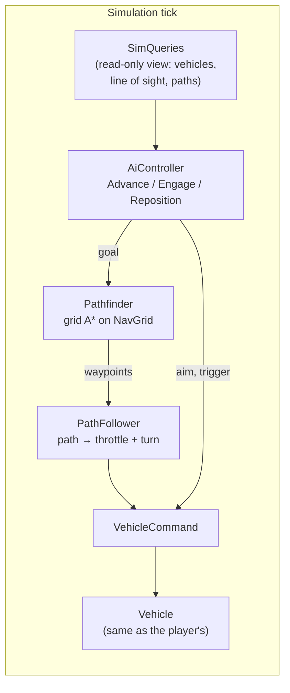
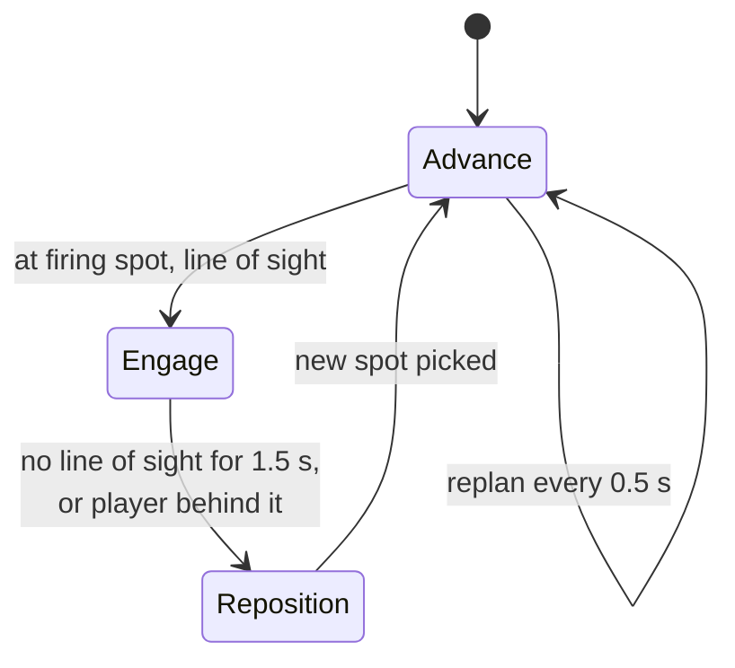

# M4 Plan — Enemy AI

_Approved by Brendan 2026-11-23. Milestone definition: [`milestones.md`](../milestones.md) § M4. Status: **in progress** (update the task table as work lands)._

**Goal:** one insurgent tank that hunts you competently.
**Done when:** an enemy paths around cover, engages, repositions when blocked, and never gets permanently stuck; pathfinding and state transitions are tested.

## How it fits together

The AI is just another `Controller`: it produces the same `VehicleCommand` a player does (throttle, turn, aim point, triggers). Everything after that (locomotion, turret, weapons, damage) is the code you already have, so enemies can't cheat physics or fire in ways the player can't.

## Decisions (approved)
| # | Question | Proposal |
|---|---|---|
| D1 | What the AI can see | **Interface change, approved (option A of three: B = hand the AI the `Simulation`, C = a central AI system):** `ControllerContext` gains `world: SimQueries`, a read-only view the `Simulation` implements: vehicles (position, heading, faction, health), `lineOfSight(from, to, ignore)`, `findPath(from, to)`. Controllers still can't change anything; they only read and return a command. The alternative (the AI reaching into `Simulation` directly) breaks rule 3's spirit and makes the AI hard to test. The view returns **read-only vehicle types**, closing today's gap where `context.vehicle` is the live object |
| D2 | Navigation grid | `NavGrid`: 0.5 u cells over the arena (92 × 92). A cell is blocked if it lies within **1.0 u** (tank half-width 0.8 + margin) of a wall, pillar or crate, so a path through open cells keeps the hull clear. Built from the sim's own shapes (rule 5), **rebuilt when a crate is destroyed**. Other tanks aren't in the grid (they move); see D6 |
| D3 | Pathfinding | `Pathfinder`: A*, 8-connected, octile distance, no cutting blocked corners. The raw cell path is **smoothed** (drop waypoints while the straight line stays in open cells), so tanks drive straight lines, not staircase zig-zags. Replans every 0.5 s (GDD), staggered by vehicle id so several enemies don't all plan on the same tick |
| D4 | Driving a path | `PathFollower` (pure function → throttle, turn): steer toward a look-ahead point ~2 u along the path; turn in place if more than 60° off, slow down for the last 2 u. Forward only, except when unsticking (D7). Uses the insurgent's normal locomotion, so it drives with the same inertia and gear change as you |
| D5 | Line of sight | `lineOfSight(from, to)`: a thin swept cast (r 0.1) from the AI's turret pivot to the target; clear if the first thing hit is the target. Crates block sight until destroyed. The same query later feeds the silhouette rule (GDD §7) |
| D6 | Other tanks | Cells under and around other vehicles get a **high cost** (not blocked) when planning, so enemies route around each other but can still squeeze past. Physics resolves bumps |
| D7 | Never stuck | Progress check: if the AI is trying to move but has moved < 0.3 u in 1 s, it **reverses with a turn for 0.6 s**, then replans. After 3 failed attempts at the same spot it picks a new firing spot. This is the direct fix for the prototype's stuck-behind-cover problem (lessons-learned) |
| D8 | Firing spots | Candidates on rings 8, 10 and 12 u around the player (24 angles each), kept if the cell is open and has line of sight to the player. Scored by path length from the AI (shorter is better), plus: **Reposition prefers spots next to cover** (a blocked cell within 2 u), and spots near other enemies score worse (spread out). Ties broken by the sim `Rng` (deterministic) |
| D9 | Engage | Stop. Turn the **hull** so its front faces the player (within 15°), since front armor is ×0.65. Turret tracks the player, **leading by `AiDef.aimLead`** (0 = aim at where the player is, 1 = full intercept). The slice uses **0** (fair and readable; at 10 u the shell takes ~0.14 s, so a moving player is missed, a still one is hit); difficulty levels can raise it later without code (Brendan: "maybe it depends on AI difficulty"). Fire when the turret is within 2° of the aim and line of sight is clear |
| D10 | Leaving Engage | Reposition if line of sight has been lost for 1.5 s (GDD), or the player is in its rear arc (> 135° off the hull's nose) within 8 u: it would rather move than turn its weak rear toward you |
| D11 | Fire telegraph (M4-5) ✅ approved | A new limiter, **`WindupLimiter`** (0.3 s = 18 ticks): the trigger must be held that long before the gun fires; releasing cancels. The sim emits `ShotTelegraphed` when a windup starts, and the render layer shows a placeholder **muzzle glow** for it (real flash in M6). Only the insurgent cannon has it in its def, so it's data, not AI code (and the "charge-up" limiter from architecture.md §4 comes for free). The AI just holds the trigger when it wants to fire. Alternative: a timer inside `AiController` (simpler, but then only the AI could ever have a windup) |
| D12 | Spread | Already in place: 3° cone from the sim `Rng` (M3) |
| D13 | Friendly fire check (M4-6) | Before and during the windup, cast along the barrel to the player's distance; if the first vehicle in the way is an ally, release the trigger. Friendly fire stays on (GDD): an ally that drives into the shot after it's fired still gets hit |
| D14 | Debug scene ✅ approved | Replace the circler and the three dummies (T-49, T-98) with **one hunting insurgent** from the top gate. `?enemies=N` (1–3) adds more from the other gates, for the spread-out and friendly-fire checks. `?dummies=on` brings the M3 dummies back for armor testing |
| D15 | Debug view | `?ai=on`: draws each enemy's path, chosen firing spot and state label ("Advance"), and `?nav=on` shades blocked grid cells. Render reads a read-only `AiController.debug` snapshot; nothing here affects the sim |
| D17 | AI tuning is data | `AiDef` in `defs/ai.ts` (rule 8), referenced from the insurgent's spawn: firing ring, tolerances, timings below, and `aimLead`. A harder enemy later is a new `AiDef`, not new code |
| D16 | M4-1 | Already done: the insurgent def and `createVehicle` landed in M2/M3. This task becomes a check of the insurgent def against GDD §5 (no code expected) |

## Starting values (GDD §5)
| Value | Proposal |
|---|---|
| Nav cell size / clearance | 0.5 u / 1.0 u |
| Replan interval | 0.5 s (30 ticks) |
| Firing ring | 8, 10, 12 u from the player |
| Look-ahead | 2 u; turn in place above 60° off |
| Engage: hull / turret tolerance | 15° / 2° |
| Lost sight → reposition | 1.5 s |
| Player-behind trigger | > 135° off the nose, within 8 u |
| Stuck | < 0.3 u in 1 s → reverse 0.6 s; 3 tries → new spot |
| Telegraph | 0.3 s (18 ticks) |
| Aim lead (`AiDef.aimLead`) | 0 (none) |

## Tasks (build order)
| Order | Task | Branch | Status |
|---|---|---|---|
| 1 | M4-1 Insurgent def check against GDD §5 | (with M4-2) | ✅ all values match |
| 2 | M4-2 `NavGrid`, `Pathfinder` (A*, smoothing, rebuild on crate break) | `m4-2-pathfinder` | ⬜ |
| 3 | M4-3 Line of sight; `SimQueries` on `ControllerContext` | `m4-3-sight` | ⬜ |
| 4 | M4-4a `PathFollower` + stuck recovery | `m4-4a-follow` | ⬜ |
| 5 | M4-4b `AiController` states, firing spots, engage; debug scene (D14), `?ai=on`, `?nav=on` | `m4-4b-ai` | ⬜ |
| 6 | M4-5 `WindupLimiter`, `ShotTelegraphed`, placeholder muzzle glow | `m4-5-telegraph` | ⬜ |
| 7 | M4-6 Ally-in-line hold fire | `m4-6-friendly-fire` | ⬜ |

## Tests (highlights)
| Area | Behaviours |
|---|---|
| NavGrid | Cells within clearance of a pillar are blocked; a destroyed crate's cells reopen; arena edges blocked |
| Pathfinder | Finds a path around a crate; no path into a sealed area (returns none, doesn't hang); never cuts a blocked corner; smoothing keeps every segment in open cells; same input → same path |
| Sight | Blocked by a pillar, by a crate until it breaks; clear past a tank's corner (oriented shapes) |
| PathFollower | Turns in place when the goal is behind; drives straight on a straight path; slows at the end |
| Stuck | A tank pinned against a wall by a scripted pusher reverses out and replans; never stuck > N s in a scenario run |
| States | Advance → Engage on reaching a spot with sight; Engage → Reposition after 1.5 s without sight; player behind → Reposition; Engage turns its front toward the player |
| Firing | Fires only when aligned with sight; windup emits `ShotTelegraphed` 18 ticks before `ShotFired`; release cancels; holds fire with an ally in line |
| Integration | Against real Rapier: an enemy from the top gate reaches a firing spot around the centre pillar and hits a still player; same seed → same game |

## Trade-offs to record
`SimQueries` on the controller context · grid (not navmesh) with a circle clearance for an oblong hull · no aim lead in the slice (tunable) · other tanks as path cost, not obstacles · windup as a limiter · debug scene replaces dummies.

## Out of scope
Waves, gates and spawning rules (M5) · real muzzle flash and other VFX (M6) · enemy health bars in the finished game (GDD §7 question, M6) · other enemy types.
