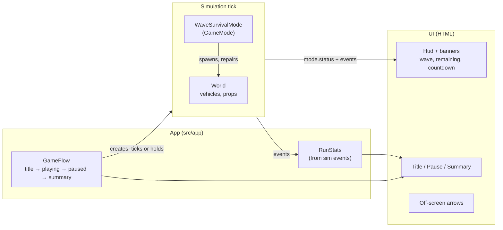
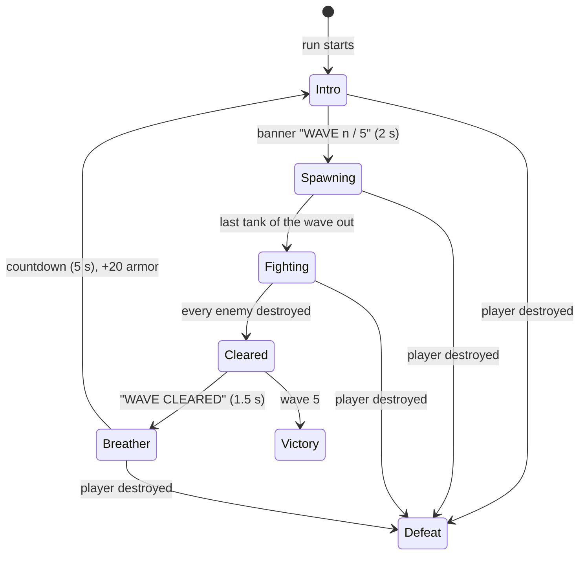

# M5 Plan — Waves and run loop

_Approved by Brendan 2026-11-23. Status: **in progress** (update the task table as work lands). Milestone definition: [`milestones.md`](../milestones.md) § M5._

**Goal:** a complete, replayable run without refreshing the page.
**Done when:** a full win and a full loss are both playable start to finish with keyboard and controller; wave logic is tested.

## How it fits together

The **sim** owns the rules of a run: when waves start, who spawns where, repairs, win and lose (`WaveSurvivalMode`, a `GameMode`). The **app** owns everything around a run: title, pause, summary, restart (`GameFlow`). Pausing is the app simply not calling `tick()`, so the sim never knows. Restart throws the `Simulation` away and builds a new one, so there is no "reset everything" code to get wrong.

### A run, on the sim's clock

A wave is a list of **spawn groups** (D2): each group comes out at its own time, as one tank or several at once, from one gate or spread over several. Each group's gate glows for 1 s before its tanks drive out (D4).

## Decisions (proposed)
| # | Question | Proposal |
|---|---|---|
| D1 | `GameMode` interface | `start(context)` once (spawns the player), `update(context)` every tick at step 6 (after removals), and a read-only `status` for the HUD (phase, wave, enemies left, countdown). `ModeContext` gives the tick, the world (to add vehicles), the arena, the events and the `Rng`. The `Simulation` takes `mode?: GameMode` beside today's `populate` (kept for tests and the sandbox). A `RoomClearMode` later is another implementation; vehicles, combat and AI don't change |
| D2 | Waves are data, and difficulty has several levers (Brendan) ✅ | `defs/waves.ts`. Each wave lists **spawn groups**: `{ at, count, from }`: `at` = seconds after the banner; `count` = tanks that come out **together**; `from` = `'one-gate'` (all from the same gate, side by side) or `'spread'` (each from a different gate). **Which gate is picked by the sim's `Rng` each run**, so the player can't learn the order and has to adapt (a group may also name a fixed gate for tutorial-style waves). Per wave: `repair` (armor fraction given in the breather after it). Levers this gives: count, timing (staggered or together), clustering (one gate vs spread), repair. **Escalation is no longer count only** (GDD §2 updated). Timings in a `WaveSurvivalDef` (banner 2 s, warning 1 s, cleared 1.5 s, breather 5 s), all whole ticks |
| D3 | Spawning ✅ | Each gate has **two spawn slots**, side by side 2.5 u inside it, facing in, so two tanks can come out of one gate together (a third waits for a slot). A slot is blocked if anything is within **3 u** of it (a tank parked at the gate, you included); a blocked group moves to the next free gate, with its own warning; if all are blocked it waits. Never stacks a tank inside another |
| D4 | Gate warning ✅ | Sim emits `GateWarning { gate, count, seconds }` **1 s** before a group (Brendan: the GDD's 2 s gave the next gate away too early; tanks still need time to drive in, aim and telegraph, so 1 s is enough to react); the render layer makes the gate marker pulse (the yellow-black panels already in the walls). Placeholder look; M6 can add light. Off-screen gates get an edge arrow (D10). The wave's order is never shown in advance |
| D5 | Wave end and enemies left | A wave is cleared when **every enemy it spawned is destroyed**, whoever destroyed it (friendly fire counts). "Enemies remaining" = alive + not yet spawned |
| D6 | Breather | Starts after "WAVE CLEARED": **the wave's `repair` at once** (default 20 % of max, capped) with a `PlayerRepaired` event (HUD bar flashes green), then a 5 s countdown. Crates stay destroyed (GDD) |
| D7 | Win and lose | Player destroyed at any point → `RunEnded { outcome: 'defeat' }` that tick; the sim keeps running for a **1.5 s destruction moment** (enemies keep moving), then the app shows the summary. Wave 5 cleared → `RunEnded { outcome: 'victory' }`, "VICTORY" banner, summary after 2 s |
| D8 | Game states (app) ✅ | `GameFlow` in `src/app`: **title → playing ⇄ paused → summary → playing (restart) or title**. Title: the arena behind a "HARDPOINT — press any key / A" card (sim built but not ticking). Pause: Esc / Start, and **automatically when the window loses focus**; menu Resume / Restart / Title. Summary: Restart (default) / Title. Menus work with mouse, keyboard (arrows + Enter, Esc = back) and pad (D-pad/stick + A, B = back) through one small `MenuNavigator` |
| D9 | Restart and seeds ✅ | Restart builds a fresh `Simulation` (same arena, crates back). Each run gets a **new seed** from the app (the sim stays deterministic per seed); `?seed=N` pins it so a run can be replayed for debugging |
| D10 | HUD (M5-6) | In the existing panel: **wave n / 5**, **enemies remaining**, and the breather countdown. Centre banners: "WAVE n / 5", "WAVE CLEARED", "VICTORY", "DESTROYED". **Edge arrows** for enemies outside the view and for warning gates outside it, placed by a pure, tested clamping function (screen point → edge position and angle) |
| D11 | Run stats (M5-5) ✅ | `RunStats` (app, pure, unit-tested) counts from sim events only: waves cleared, time (ticks), kills (your shot made the destroying hit), shots fired / hit / accuracy **per weapon** (a hit = struck an enemy vehicle; crates and walls don't count), damage taken. The summary screen shows them (GDD §9). No new sim state |
| D12 | Sandbox stays ✅ | The page **defaults to the real game** (title screen). Today's debug scene moves behind **`?mode=sandbox`** (with `?enemies=`, `?dummies=`); `?wave=N` starts a run at wave N for testing. The `?hp`, `?ai`, `?nav` overlays work in both |
| D14 | Crates resetting ✅ (deferred) | Not in M5: the GDD keeps crates destroyed for the run, and the post-slice backlog already has "crate rebuild between waves". If wanted later it's a per-wave `restoreCrates` flag; the work is respawning only crates whose spot is clear of tanks and rebuilding the nav grid |
| D13 | Health repair | `Health.repair(amount)` (capped at max). `Health` is not one of the CLAUDE.md interfaces; noted for completeness |

## Starting values (GDD §2, §4)
| Value | Proposal |
|---|---|
| Banner before a wave | 2 s (the first gate warning runs during it) |
| Gate warning | 1 s before each group emerges |
| "WAVE CLEARED" | 1.5 s |
| Breather | 5 s countdown; the wave's repair at its start |
| Defeat moment / victory hold | 1.5 s / 2 s |
| Gate blocked if anything within | 3 u of the spawn point |

### Starting waves (`at` = seconds after the banner; gates picked per run)
| Wave | Groups | What it asks of you |
|---|---|---|
| 1 | 1 tank at 0 | Basics |
| 2 | 1 at 0 · 1 at 4, spread | A second angle, with time to deal with the first |
| 3 | 2 together from one gate at 0 · 1 at 5 from another | A pair to fight, then a flank |
| 4 | 3 at 0, spread (all gates at once) · 1 at 6 | Surrounded, then one more |
| 5 | 2 together from one gate at 0 · 2 together from another at 3 · 1 at 7 | Two pushes and a straggler |

Repair after each of waves 1–4: 20 % (GDD). Counts stay 1 → 5; numbers are for tuning in play.

## Tasks (build order)
| Order | Task | Branch | Status |
|---|---|---|---|
| 1 | M5-1 `GameMode`, `WaveSurvivalMode` (phases, spawning, clear, win/lose), `defs/waves.ts`; `?mode=sandbox`, `?wave=N`; game starts straight into wave 1 (no menus yet) | `m5-1-waves` | ✅ |
| 2 | M5-2 Gate warnings (`GateWarning`, gate pulse), blocked-gate fallback | `m5-2-gates` | ✅ |
| 3 | M5-3 Breather: countdown, repair, `PlayerRepaired` | `m5-3-breather` | ✅ |
| 4 | M5-6a HUD: wave, enemies left, countdown, banners (so M5-1–3 are playable and visible) | `m5-6a-hud` | ✅ |
| 5 | M5-4 `GameFlow`: title, pause (incl. blur), summary shell, restart, `MenuNavigator`, new seed per run | `m5-4-flow` | ✅ |
| 6 | M5-5 `RunStats` and the summary screen | `m5-5-stats` | ✅ |
| 7 | M5-6b Off-screen enemy and gate arrows | `m5-6b-indicators` | ✅ |
| 8 | Done-when check: a full win and a full loss with keyboard and with the pad | — | ⬜ |

## Tests (highlights)
| Area | Behaviours |
|---|---|
| Wave flow | Groups spawn at their `at` times; `one-gate` puts a group side by side at one gate, `spread` uses different gates; gate picks come from the seed (same seed → same gates, different seed → different); a wave clears only when all its tanks are destroyed (including by friendly fire); wave n+1 starts after cleared + breather; enemies remaining counts unspawned tanks |
| Gates | Warning precedes each group by 1 s; a blocked gate falls through to the next free one; all blocked → waits, then spawns once clear; a group of 3 at one gate uses both slots, then the third waits |
| Breather | The wave's repair, capped at max; countdown in whole ticks; no spawns during it |
| End | Player destroyed → defeat that tick, in any phase; wave 5 cleared → victory; nothing spawns after the run ends |
| Determinism | Same seed + same commands → same run (wave timings, spawns) |
| Stats | Kills only for your destroying hits; accuracy per weapon (crate hits don't count); damage taken sums `Hit`s on you |
| UI maths | Edge-arrow clamping (on-screen → none; off each edge and corner → clamped point and angle); menu navigation wraps; `GameFlow` transitions (title → playing, pause/resume, blur pauses, summary → restart builds a new sim) |
| Integration | Real Rapier, slice arena, scripted player that never dies (huge armor) and an "assistant" that destroys enemies: all 5 waves run to victory with the right spawn counts |

## Trade-offs to record
Restart by rebuilding the sim · waves as timed spawn groups with gates picked by the seed · two spawn slots per gate · blocked gate falls through · stats in the app from events · title shows the live arena, idle · new seed per run.

## Out of scope
Sounds for wave start / clear (M6-6) · explosions on death (M6-3) · settings, rebinding, save data (post-slice) · difficulty levels (post-slice backlog) · enemy health bars in the finished game (M6 question).
