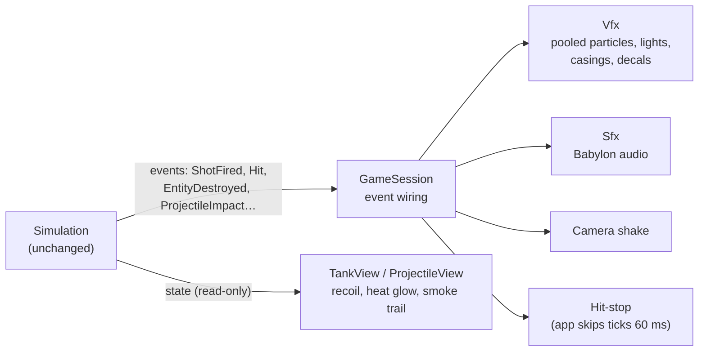

# M6 Plan — Feel and effects ("juice")

_Approved by Brendan 2026-11-24. Status: **in progress** (update the task table as work lands). Milestone definition: [`milestones.md`](../milestones.md) § M6._

**Goal:** hits feel heavy and the screen stays readable.
**Done when:** every GDD §8 item and the §7 silhouettes and shadows are in; effects never hide projectiles or enemies.

## How it fits together

Everything in M6 is **render, audio or app side**. The simulation doesn't change: it already emits every event these effects need (lessons-learned: the prototype's effects were ad-hoc meshes mixed into gameplay code; here they hang off events and are pooled). Hit-stop is the one effect that touches time, and it does it the same way pause does: the app simply doesn't tick for 60 ms, so the sim stays deterministic.

## Decisions (approved)
| # | Question | Proposal |
|---|---|---|
| D1 | Effect architecture | A `Vfx` system in `render/vfx/` owns **pooled** particle systems, lights and meshes, created once and reused (never new geometry per shot, the prototype's mistake). Effects are **data** (`render/vfx/effects.ts`: colours, sizes, lifetimes, counts), the render-side twin of rule 8. Triggered from sim events by the session; views add what follows an entity (trail, recoil, glow) |
| D2 | Particle authoring ✅ **A** (Brendan, "for now") | **A: particle systems defined in TypeScript** as effect defs (a factory builds pooled Babylon `ParticleSystem`s from them; tune by editing numbers). B (Babylon's built-in presets) is quicker but generic, and fetches its JSON from Babylon's CDN at runtime unless copied in. C (Node Particle Editor) is a visual editor exporting JSON: great for iterating on looks, but a new tool and workflow, its JSON is hard to review, and it is newer in Babylon. A keeps everything in git, tunable by numbers. Industry tools are visual editors (Niagara, VFX Graph), so C stays an option for a single "hero" effect later (the tank explosion would suit). Babylon's Inspector for live tuning would be a new dev dependency: ask first |
| D3 | Particle textures | ~~A free CC0 pack (Kenney's Particle Pack) in `public/vfx/`~~ **Changed in M6-1a:** kenney.nl refuses automated downloads, so the three textures (soft dot, smoke puff, spark) are **drawn in code** at startup (`particleTextures.ts`): no files, no licences. A downloaded pack can replace that one module later (Brendan can download it by hand). `CREDITS.md` arrives with the first real asset (sounds, M6-6) |
| D4 | Sound source (Brendan asked: easiest, free, high quality) | **Kenney's CC0 audio packs** (sci-fi, impact and explosion sets): free, no attribution required, consistent quality, ready-to-use short files. For the cannon and big explosions, if Kenney's feel too light: **Sonniss' free GDC bundles** (professional, royalty-free, large downloads to pick from). Not recommended: generated retro sounds (jsfxr: free but chiptune-sounding); freesound.org (great finds but mixed licences and quality, slow to curate). Files in `public/audio/`, listed in `CREDITS.md` |
| D5 | Sound playback | Babylon's own audio engine (already in Babylon: no new dependency). Audio unlocks on the first key or click, which the title screen already asks for. Volume falls off with distance from the camera focus and pans left/right; each sound has a voice limit so the MG doesn't stack 12 copies a second. `?sound=off` |
| D6 | Screen shake | Render-only "trauma" model on `SliceCamera` (shake grows with trauma squared, decays over ~0.4 s). GDD amounts: own cannon fire small, player hit medium, a kill within ~12 u medium. `?shake=off` |
| D7 | Hit-stop ✅ **(b)** (Brendan, "for now") | ~60 ms freeze **only when the player destroys a tank** (not enemies killing each other), so frequent freezes don't read as stutter. The app holds ticks; the frame keeps rendering. `?hitstop=off` to compare in play |
| D8 | Hit flash | A tank that takes damage flashes white-hot for ~0.1 s (emissive on its materials) |
| D9 | Muzzle flash and recoil | A pooled point light plus a flash sprite at the muzzle for ~50 ms; the cannon barrel kicks back and springs forward (`TankModel`, render-only, like the hull pitch). Enemies too. Replaces the "point-blank shots are visible for one frame" follow-up if the flash covers it |
| D10 | **Cannon smoke trail** ✅ (Brendan: like Halo and the prototype) | Every cannon shell (yours and enemies') leaves a smoke trail: particles emitted along its path that stay where they were left, grow and fade over ~1.2 s, so the trail dissipates behind the shell. MG tracers get none (too many, and the tracer already reads). Likely also fixes the "clunky" cannon-shell look (follow-up): the trail shows the path between frames |
| D11 | Shell casings (Brendan) | Pooled meshes with render-only arcs and one floor bounce, fading after ~2 s, capped (oldest reused). MG: small brass to the right of the coax; cannon: a big case out of the back of the turret |
| D12 | Explosions and destruction ✅ | Tank destroyed: fireball, sparks, a smoke column (~2 s), a scorch decal on the floor. No wreck (tanks vanish as now; wrecks would be cover and need sim work: post-slice backlog) |
| D13 | Impacts | Replace the M3 placeholder flash: sparks and a dust puff by surface (tank: sparks; wall, pillar, crate: dust and chips) |
| D14 | Crates, treads, MG heat | Crate breaks into 4–6 tumbling chunks that fade (render-only, not collidable). Tread marks: two fading strips under each moving tank (a pooled ribbon, capped). MG barrel glows from dull red to orange with heat (reads `HeatLimiter` state) |
| D15 | Bloom ("what is bloom?") | A post-processing pass: very bright pixels bleed a soft glow into their surroundings, like a camera lens. Makes muzzle flashes, tracers, fire and warning lights look hot. Babylon's `DefaultRenderingPipeline`, with a high threshold so only emissive things glow (never the whole scene washing out). `?bloom=off`. Costs a few GPU passes; checked in the M6 perf pass |
| D16 | Shadows | One shadow map from the sun: tanks and props cast, the floor receives (GDD §7). `?shadows=off` |
| D17 | Silhouettes (M6-7) | Brendan: not important now, decide the style at the end of the slice. Built as the **last M6 task** with a quick choice then (flat colour vs outline), or moved to M7 tuning if time is short |
| D18 | Placeholders and follow-ups | Gate warning gets a real light; the impact flash goes (D13). Revisit in M6: point-blank flight (D9), cannon shell look (D10), barrel bob, MG heat bar colours, enemy health bars in the finished game (GDD §7 question) |
| D19 | Readability guard | Effects draw under projectiles and tanks where possible, smoke is kept thin and short-lived, and a test scene (`?mode=sandbox&enemies=3`) is used to check nothing hides a shell or an enemy (the done-when) |

### D2 trade-offs in one table
| | A: TypeScript defs (recommended) | B: Built-in presets | C: Node Particle Editor |
|---|---|---|---|
| Speed to first effect | Medium | Fastest | Slow (learn the tool) |
| Look | As good as we tune it | Generic | Best for complex effects |
| Iterating on looks | Edit numbers, reload | Edit JSON | Visual, live |
| Reviewable in git | Yes, readable code | JSON | Large JSON graphs |
| Runtime fetch | None | Babylon CDN unless copied in | None if exported locally |
| Fits "content is data" | Yes | Partly | Partly |

## Tasks (build order)
| Order | Task | Branch | Status |
|---|---|---|---|
| 1 | M6-1a `Vfx` pool + effect defs, particle textures, `CREDITS.md`; impact sparks and dust (D1–D3, D13) | `m6-1a-vfx` | ✅ |
| 2 | M6-2a Muzzle flash light and sprite, cannon recoil, **cannon smoke trail** (D9, D10) | `m6-2a-muzzle` | ✅ |
| 3 | M6-1b Screen shake, hit-stop, hit flash (D6–D8) | `m6-1b-impact-feel` | ✅ |
| 4 | M6-7a Shadows (D16) (moved up by Brendan, 2026-11-25) | `m6-7a-shadows` | ✅ |
| 5 | M6-3 Explosions, smoke column, scorch (D12) | `m6-3-explosions` | ⬜ |
| 6 | M6-2b Shell casings (D11) | `m6-2b-casings` | ⬜ |
| 7 | M6-4 Crate chunks, tread marks, MG heat glow (D14) | `m6-4-details` | ⬜ |
| 8 | M6-6 Sounds (D4, D5) | `m6-6-sound` | ⬜ |
| 9 | M6-5 Bloom (D15) | `m6-5-bloom` | ⬜ |
| 10 | M6-7b Silhouettes (style chosen then, D17) | `m6-7b-silhouettes` | ⬜ |
| 11 | Follow-ups pass (D18) and readability check (D19); done-when | — | ⬜ |

## Tests
Effects aren't unit-tested (rendering rule), but the maths behind them is, as with the HUD: shake decay, recoil spring, casing arcs and bounce, trail fade, distance falloff and pan for sound, voice limiting, hit-stop timing in `GameFlow`/frame logic, pool reuse (never more than the cap). Everything else is checked in play.

## Trade-offs to record
Effects as TypeScript defs (not presets or the editor) · CC0 asset packs · hit-stop by holding ticks · no wrecks · casings and chunks not collidable · bloom threshold high.

## Out of scope
Music (GDD §10) · wrecks as cover · physics-driven debris · settings menu for volume (post-slice) · silhouette style (decided at D17).
